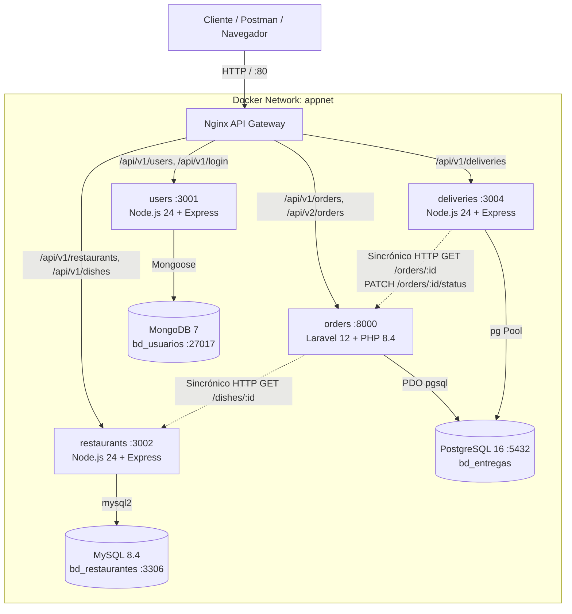

# Práctica: Microservicios Políglotas "Delivery Sucre"

Sistema distribuido basado en una arquitectura de microservicios heterogéneos (Node.js y Laravel 12) sobre persistencia políglota (MongoDB, MySQL y PostgreSQL), orquestados con Docker Compose y expuestos a través de un proxy inverso Nginx que actúa como API Gateway centralizado.

---

## 1. Diagrama de Arquitectura Final

### Diagrama de Despliegue y Comunicación (Mermaid)



### Diagrama de Flujo de Datos y Topología

```text
cliente ──► nginx:80 ──┬─ /api/v1/users, /login ──────► users (Node) ────────► MongoDB (bd_usuarios)
                       ├─ /api/v1/restaurants, /dishes ► restaurants (Node) ──► MySQL (bd_restaurantes)
                       ├─ /api/v1/orders, /api/v2/orders ► orders (Laravel) ──► PostgreSQL (bd_pedidos)
                       └─ /api/v1/deliveries ──────────► deliveries (Node) ──► PostgreSQL (bd_entregas)

Comunicación sincrónica interna (HTTP reenviando JWT):
• orders ─────── GET /api/v1/dishes/{id} ──────────► restaurants (valida plato y precio real en MySQL)
• deliveries ─── GET /api/v1/orders/{id} ──────────► orders (verifica que pedido esté en_preparacion)
• deliveries ─── PATCH /api/v1/orders/{id}/status ──► orders (propaga 'en_camino' y 'entregado')
```

---

## 2. Instrucciones de Despliegue y Arranque

### Requisitos Previos
* Docker Desktop (v4.x o superior) con Docker Compose v2 y soporte WSL 2 (en Windows).
* Postman (para ejecutar la colección de pruebas).

### Despliegue Limpio desde Cero
Para levantar toda la infraestructura desde cero con los scripts de inicialización y bases de datos vírgenes:

```bash
docker compose down -v
docker compose up -d --build
```

### Verificación de Estado
Comprueba que todos los contenedores se encuentren levantados (`Up`) y que los tres motores de bases de datos reporten estado `healthy`:

```bash
docker compose ps
```

Deberás ver los 8 servicios activos:
* `mongodb_usuarios` (healthy en puerto 27017)
* `mysql_restaurantes` (healthy en puerto 3306)
* `postgres_pedidos` (healthy en puerto 5432 con bases `bd_pedidos` y `bd_entregas`)
* `service_users` (puerto 3001)
* `service_restaurants` (puerto 3002)
* `service_orders` (puerto 8000)
* `service_deliveries` (puerto 3004)
* `nginx_gateway` (puerto 80)

---

## 3. Credenciales y Usuarios Iniciales

* **Secreto JWT compartido:** `deliverySucre2026superSecreto`
* **Administrador inicial (creado en `mongo/init/01-admin.js`):**
  * Email: `admin@delivery.bo`
  * Contraseña: `admin123`
  * Rol: `admin`
* **Usuarios de prueba sugeridos:**
  * Cliente: `ana@correo.bo` / `ana123` (rol: `cliente`)
  * Repartidor: `luis@correo.bo` / `luis123` (rol: `repartidor`)

---

## 4. Tabla de Endpoints de la API

Todas las peticiones públicas pasan por el **API Gateway Nginx** en `http://localhost`:

| Método | Endpoint | Microservicio | Base de Datos | Rol / Permiso | Descripción |
| :--- | :--- | :--- | :--- | :--- | :--- |
| **GET** | `/` | Nginx Gateway | — | Público | Estado del API Gateway y servicios activos. |
| **POST** | `/api/v1/login` | `users` | MongoDB | Público | Autenticación con email/password. Retorna JWT (HS256). |
| **POST** | `/api/v1/users` | `users` | MongoDB | Público / Admin | Registro de nuevos usuarios (`cliente`, `repartidor`, `admin`). |
| **GET** | `/api/v1/users` | `users` | MongoDB | Admin | Lista usuarios registrados con filtros por rol. |
| **GET** | `/api/v1/login/me` | `users` | MongoDB | Autenticado | Devuelve perfil del usuario según el token JWT. |
| **GET** | `/api/v1/restaurants` | `restaurants` | MySQL | Autenticado | Catálogo de restaurantes registrados. |
| **POST** | `/api/v1/restaurants` | `restaurants` | MySQL | Admin | Registra un nuevo restaurante en el catálogo. |
| **GET** | `/api/v1/restaurants/:id/dishes` | `restaurants` | MySQL | Autenticado | Menú de platos del restaurante especificado. |
| **GET** | `/api/v1/dishes/:id` | `restaurants` | MySQL | Autenticado | Obtiene plato y precio real (usado por orders). |
| **POST** | `/api/v1/dishes` | `restaurants` | MySQL | Admin | Agrega un nuevo plato asociado a un restaurante. |
| **POST** | `/api/v1/orders` | `orders` | PostgreSQL (`bd_pedidos`) | Cliente / Admin | Crea un pedido calculando el total real vía MySQL. |
| **GET** | `/api/v1/orders` | `orders` | PostgreSQL (`bd_pedidos`) | Autenticado | Cliente ve solo sus pedidos; Admin/Repartidor ven todos. |
| **GET** | `/api/v1/orders/:id` | `orders` | PostgreSQL (`bd_pedidos`) | Autenticado | Detalle completo de un pedido y sus ítems. |
| **PATCH** | `/api/v1/orders/:id/status` | `orders` | PostgreSQL (`bd_pedidos`) | Admin / Repartidor | Actualiza el estado (`confirmado`, `en_preparacion`, etc.). |
| **DELETE** | `/api/v1/orders/:id` | `orders` | PostgreSQL (`bd_pedidos`) | Admin | Elimina un pedido y sus ítems en cascada. |
| **POST** | `/api/v1/deliveries` | `deliveries` | PostgreSQL (`bd_entregas`) | Admin | Asigna entrega si pedido existe y está `en_preparacion`. |
| **GET** | `/api/v1/deliveries` | `deliveries` | PostgreSQL (`bd_entregas`) | Admin / Repartidor | Admin ve todas; Repartidor ve solo sus asignaciones. |
| **GET** | `/api/v1/deliveries/:id` | `deliveries` | PostgreSQL (`bd_entregas`) | Autenticado | Consulta la entrega e incluye el pedido consultado a orders. |
| **GET** | `/api/v1/deliveries/order/:orderId` | `deliveries` | PostgreSQL (`bd_entregas`) | Autenticado | Busca la entrega asociada a un ID de pedido. |
| **PUT** | `/api/v1/deliveries/:id/status` | `deliveries` | PostgreSQL (`bd_entregas`) | Repartidor asignado / Admin | Avanza estado (`recogido` ➔ `en_camino` ➔ `entregado`) y propaga. |
| **DELETE** | `/api/v1/deliveries/:id` | `deliveries` | PostgreSQL (`bd_entregas`) | Admin | Elimina una entrega registrada. |

---

## 5. Mejoras Implementadas en el API Gateway (C.2)

1. **Rate Limiting en Login (`/api/v1/login`):**
   * Zona de memoria compartida de 10 MB (`limit_req_zone $binary_remote_addr zone=login:10m rate=5r/m;`).
   * Limita a **5 peticiones por minuto** con ráfaga máxima de 3 (`burst=3 nodelay`).
   * Peticiones excedentes son bloqueadas inmediatamente con **`429 Too Many Requests`**.
2. **Versionado Transparente (`/api/v2/orders`):**
   * Nginx enruta `/api/v2/orders` inyectando la cabecera `proxy_set_header X-Api-Version 2;`.
   * El servicio de pedidos en Laravel captura la cabecera, registra el acceso en los logs y devuelve `X-Api-Version: 2` en los encabezados HTTP de respuesta.

---

## 6. Pruebas de Integración con Postman

Se incluye el archivo actualizado [Delivery.postman_collection.json](./Delivery.postman_collection.json).
Al importarlo en Postman, ejecute las carpetas en el siguiente orden:

1. **`0. Gateway`:** Comprueba la conectividad al proxy inverso Nginx.
2. **`1. Users`:** Login del administrador inicial, registro de cliente y repartidor.
3. **`2. Restaurants`:** Consulta del catálogo de restaurantes y menús.
4. **`3. Orders`:** Creación de pedido, validación de platos y cambio de estados a confirmado y preparación.
5. **`4. Deliveries`:** Asignación de entrega, validación de estados 409/404, avance secuencial de repartidor y verificación de cierre automático de la orden.
